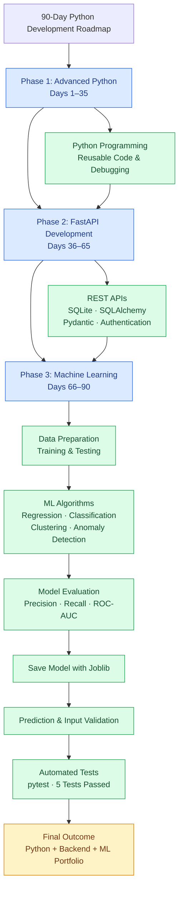

# Python Development, FastAPI & Machine Learning Roadmap

A structured, hands-on **90-day learning journey** covering advanced Python, backend development with FastAPI, and practical machine learning. This repository documents daily practice, notes, implementations, experiments, and projects built while developing skills for AI/ML engineering and open-source contribution.

**Author:** Surya Rathore  
**Institution:** IIITDM Jabalpur  
**Program:** B.Tech — Smart Manufacturing  
**Status:** 90-day roadmap completed

---

## Table of Contents

- [Overview](#overview)
- [Roadmap at a Glance](#roadmap-at-a-glance)
- [Workflow Architecture](#workflow-architecture)
- [Phase 1: Advanced Python](#phase-1-advanced-python-days-135)
- [Phase 2: FastAPI Development](#phase-2-fastapi-development-days-3665)
- [Phase 3: Machine Learning](#phase-3-machine-learning-days-6690)
- [Featured Projects](#featured-projects)
- [Repository Structure](#repository-structure)
- [Technologies Used](#technologies-used)
- [Getting Started](#getting-started)
- [Testing and Code Quality](#testing-and-code-quality)
- [Key Learning Outcomes](#key-learning-outcomes)
- [Future Improvements](#future-improvements)

---

## Overview

The goal of this roadmap was to move beyond basic programming and develop practical skills for building, testing, and maintaining Python applications and machine learning systems.

The roadmap was divided into three phases:

1. **Advanced Python:** Strengthen programming fundamentals and learn techniques for writing maintainable Python code.
2. **FastAPI Development:** Build REST APIs, work with databases, validate requests, and implement authentication.
3. **Machine Learning:** Practice supervised and unsupervised learning, model evaluation, preprocessing pipelines, anomaly detection, and model testing.

The final phase culminated in an end-to-end anomaly detection project using Scikit-learn and Isolation Forest.

## Roadmap at a Glance

| Phase | Days | Focus | Outcome |
|---|---:|---|---|
| Advanced Python | 1–35 | Python programming and development practices | Stronger Python foundation |
| FastAPI | 36–65 | REST APIs, databases, schemas, authentication | Student Management API |
| Machine Learning | 66–90 | ML algorithms, evaluation, deployment fundamentals, testing | Anomaly Detection project |
| **Total** | **90 days** | **Python → Backend → ML** | **Completed roadmap** |

## Workflow Architecture

The diagram below shows the progression of the 90-day roadmap and the workflow used to build, evaluate, and test the final machine learning capstone.



## Phase 1: Advanced Python (Days 1–35)

**Objective:** Develop the Python skills required to write structured, reusable, and maintainable applications.

This phase focused on strengthening Python programming and preparing for backend development and machine learning work.

### Focus areas

- Python programming and problem-solving
- Functions, modules, and code organization
- Object-oriented programming and reusable components
- Error handling and debugging
- Working with data and common Python libraries
- Writing maintainable code for larger projects

**Outcome:** A stronger foundation for developing backend services and implementing machine learning workflows.

> Refer to the corresponding day-wise folders and notes in the repository for the exact topics and exercises completed.

## Phase 2: FastAPI Development (Days 36–65)

**Objective:** Learn to develop backend applications and expose functionality through REST APIs.

### Main technologies

- Python
- FastAPI
- SQLite
- SQLAlchemy
- Pydantic
- Uvicorn
- Environment variables and configuration
- Password hashing and JWT authentication

### Featured project: Student Management API

The Student Management API provides endpoints for managing student records and demonstrates how to organize a small backend application.

**Implemented functionality**

- Create student records
- Retrieve all students and individual records
- Update existing records
- Delete records
- Validate request data using Pydantic
- Persist data using SQLite and SQLAlchemy
- Handle common HTTP errors and status codes
- Support pagination and sorting
- Organize business logic into service modules
- Implement user-related schemas and authentication components

**Outcome:** Practical experience with API design, database integration, validation, and backend application structure.

## Phase 3: Machine Learning (Days 66–90)

**Objective:** Apply machine learning algorithms, evaluate models, and build reproducible ML workflows.

### Topics covered

| Area | Concepts and techniques |
|---|---|
| Data preparation | Training/testing splits and preprocessing |
| Regression | Linear regression, polynomial features, Ridge regression |
| Classification | Classification models and prediction workflows |
| Evaluation | MAE, RMSE, R², precision, recall, F1-score, confusion matrix, ROC-AUC |
| Ensemble learning | Random Forest and XGBoost |
| Clustering | K-Means and DBSCAN |
| Dimensionality reduction | PCA and t-SNE |
| Anomaly detection | Isolation Forest and Local Outlier Factor |
| ML engineering | Pipelines, model persistence, inference, validation, automated tests |

### Final capstone: Anomaly Detection

The final project uses **Scikit-learn's Isolation Forest** to identify potentially anomalous observations in a two-dimensional synthetic dataset.

The project covers the complete workflow:

1. Generate and prepare a dataset.
2. Split the data into training and testing subsets.
3. Build a preprocessing and anomaly detection pipeline.
4. Train the model and evaluate its predictions.
5. Save the fitted pipeline with Joblib.
6. Load the saved model for inference.
7. Validate prediction inputs.
8. Run automated tests for important edge cases.

**Example evaluation results from the synthetic test split**

| Metric | Result |
|---|---:|
| Precision | 0.429 |
| Recall | 1.000 |
| F1-score | 0.600 |
| ROC-AUC | 1.000 |

These results are specific to the generated dataset and evaluation split. They should not be interpreted as evidence of equivalent performance on real-world data. In particular, the precision score indicates that some normal observations were incorrectly flagged as anomalies.

## Featured Projects

### 1. Student Management API

**Stack:** Python, FastAPI, SQLite, SQLAlchemy, Pydantic

A backend application for managing student records, with CRUD operations, validation, database integration, pagination, and sorting.

### 2. Anomaly Detection using Isolation Forest

**Stack:** Python, NumPy, Scikit-learn, Joblib, pytest

An end-to-end machine learning project featuring a reusable pipeline, model persistence, prediction validation, evaluation metrics, and automated tests.

**Project location:** `03_Advanced_ML/Day88_Anomaly_Detection_Project/`

The project's own README contains its setup instructions, model details, usage examples, evaluation results, and limitations.

## Repository Structure

The repository is organized around the roadmap's learning phases and supporting notes. The example tree below highlights known project files; adjust phase-folder names if your local repository uses a different structure.

```text
Python-Development-Roadmap/
├── 03_Advanced_ML/
│   └── Day88_Anomaly_Detection_Project/
│       ├── detector.py
│       ├── train.py
│       ├── predict.py
│       ├── test_predict.py
│       ├── requirements.txt
│       ├── anomaly_detector.joblib
│       └── README.md
├── Notes/
│   └── ML_Notes.md
└── README.md
```

## Technologies Used

**Programming**
- Python

**Backend development**
- FastAPI
- Uvicorn
- Pydantic
- SQLAlchemy
- SQLite

**Machine learning and data**
- NumPy
- Scikit-learn
- XGBoost
- Joblib

**Testing and development**
- pytest
- Git
- GitHub
- Visual Studio Code

## Getting Started

### Prerequisites

Install Python and Git. A virtual environment is recommended to isolate project dependencies.

Check your installations:

```bash
python --version
git --version
```

### 1. Clone the repository

```bash
git clone https://github.com/suryapsrathore339-hue/Python-Development-Roadmap.git
cd Python-Development-Roadmap
```

### 2. Navigate to the ML capstone

```bash
cd 03_Advanced_ML/Day88_Anomaly_Detection_Project
```

### 3. Create and activate a virtual environment

**Windows PowerShell**

```powershell
python -m venv .venv
.\.venv\Scripts\Activate.ps1
```

If PowerShell activation is restricted, use the environment's Python executable directly instead.

### 4. Install dependencies

```bash
python -m pip install -r requirements.txt
```

### 5. Train the model

```bash
python train.py
```

This generates the synthetic dataset, trains and evaluates the pipeline, and saves `anomaly_detector.joblib`.

### 6. Run predictions

```bash
python predict.py
```

The prediction script loads the saved model and classifies example observations.

### 7. Run automated tests

Install pytest if it is not already available:

```bash
python -m pip install pytest
```

Then run:

```bash
python -m pytest test_predict.py -v
```

The test suite checks prediction shape, valid output labels, invalid feature counts, non-finite values, and empty inputs.

## Testing and Code Quality

Testing is an important part of the final ML project. The capstone includes automated checks for expected behavior and invalid inputs.

The five implemented test cases cover:

- Correct prediction output shape
- Valid prediction labels
- Rejection of inputs with an incorrect feature count
- Rejection of NaN and other non-finite values
- Rejection of empty input

**Latest recorded validation:** 5/5 tests passed on the development machine.

Reproducibility also depends on compatible Python and library versions. For repeatable results, record dependency versions and rerun the tests after changing the environment or model.

## Key Learning Outcomes

By completing this roadmap, I practiced:

- Writing structured Python applications
- Building and testing REST APIs
- Connecting APIs to a relational database
- Validating requests and handling errors
- Implementing authentication-related components
- Training and evaluating regression and classification models
- Applying clustering and dimensionality reduction
- Building Scikit-learn pipelines
- Saving and loading fitted ML models
- Validating prediction inputs and handling edge cases
- Using Git and GitHub to maintain project history

## Future Improvements

Potential next steps include:

- Serve the anomaly detection model through a FastAPI endpoint.
- Evaluate the model on representative, labelled real-world data.
- Compare Isolation Forest with other anomaly detection methods.
- Improve dependency management and reproducible environment setup.
- Add visualizations and more comprehensive model evaluation.
- Explore deployment, logging, and monitoring for ML applications.
- Contribute to established open-source machine learning projects.

## Acknowledgements

This repository represents a self-directed learning project built through daily practice, experimentation, debugging, and iterative improvement.

The roadmap is complete, but the learning continues through practical projects, open-source contributions, and deeper exploration of machine learning engineering.

---

**Maintained by Surya Rathore**  
B.Tech — Smart Manufacturing, IIITDM Jabalpur

[View the repository on GitHub](https://github.com/suryapsrathore339-hue/Python-Development-Roadmap)
